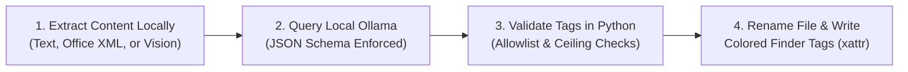

# AI Auto Renamer (`Smart Rename`)

**AI Auto Renamer** is a local-first macOS Finder Quick Action (**`Smart Rename`**) and command-line utility that analyzes the actual content of your documents using a local **[Ollama](https://ollama.com/)** model (`gemma4:26b` by default), renames each file in place with a clean, consistent filename, and applies validated **macOS Finder Tags** using a **Domain At-a-Glance Color Schema**.

Everything runs **100% locally on your Mac** — no cloud APIs, no external Python packages (`pip` is not required), and no document data ever leaves your machine.

---

## Table of Contents

1. [What Is This Project & What Is It For?](#1-what-is-this-project--what-is-it-for)
2. [Supported Document Formats](#2-supported-document-formats)
3. [How Tagging & Finder Colors Work](#3-how-tagging--finder-colors-work)
4. [Prerequisites](#4-prerequisites)
5. [How to Install](#5-how-to-install)
6. [How to Use & Manage It](#6-how-to-use--manage-it)
7. [How to Customize It](#7-how-to-customize-it)
   - [7.1 `config/settings.json` — Model, Naming Style, Limits & File Types](#71-configsettingsjson--model-naming-style-limits--file-types)
   - [7.2 `config/tags.json` — Tag Vocabulary, Limits & Finder Colors](#72-configtagsjson--tag-vocabulary-limits--finder-colors)
   - [7.3 `config/system_prompt.md` — AI Instructions & Prompt Template](#73-configsystem_promptmd--ai-instructions--prompt-template)
8. [Verification & Testing](#8-verification--testing)

---

## 1. What Is This Project & What Is It For?

Downloaded bills, contracts, bank statements, meeting notes, slide decks, and scanned receipts often arrive with unhelpful filenames like `INV_994812_final(1).pdf`, `scan_0042.png`, or `notes_oct.md`. Manually opening every file to rename it and tag it in Finder is tedious and inconsistent.

**AI Auto Renamer (`Smart Rename`)** solves this directly inside macOS Finder:



1. **Reads the real document content:** Instead of guessing from the old filename alone, it extracts text or page images from the document itself.
2. **Generates a clean, structured filename:**
   - **`date`**: Extracts the primary date stated inside the document or filename (invoice date, meeting date, contract date, report date) and normalizes it to `YYYY-MM-DD` — or omits the date if none exists.
   - **`title`**: Generates a concise, descriptive **3-to-7 word** title in Title Case (`"CloudTools Annual Subscription Invoice"`).
   - **Safe in-place rename:** Never overwrites an existing file (automatically appends ` (2)`, ` (3)`, etc. on collision):
     - *With date:* `2026-10-12 - CloudTools Annual Subscription Invoice.pdf`
     - *Without date:* `OAuth 2.0 PKCE Token Refresh Specification.md`
3. **Applies validated macOS Finder tags & colors:** Assigns 2–4 tags from a strict, customizable vocabulary so you can filter files across folders in Finder and Spotlight (`tag:invoice`, `tag:finance`, `tag:contract`)—working seamlessly on both local folders and **iCloud Drive**.

---

## 2. Supported Document Formats

| Category | Extensions | How Content Is Read Locally |
| :--- | :--- | :--- |
| **Plain Text, Markdown & Code** | `.txt`, `.md`, `.csv`, `.json`, `.yaml`, `.py`, `.js`, `.ts`, `.sh`, `.html`, `.xml`, etc. | Direct UTF-8 text loader |
| **Images (Vision)** | `.png`, `.jpg`, `.jpeg`, `.webp`, `.gif` | Sent as base64 images to your local multimodal Ollama model |
| **PDF Documents** | `.pdf` | Digital text extracted via `pdftotext` + `pdfinfo`. If a PDF has `< 40` characters of selectable text (such as a scanned receipt or form), pages 1–2 are automatically rendered via `pdftoppm` and analyzed with Vision |
| **Word & Rich Text** | `.docx`, `.doc`, `.rtf`, `.odt` | Extracted via macOS `/usr/bin/textutil` (with built-in ZIP/XML fallback) |
| **Spreadsheets** | `.xlsx`, `.ods` | Native Python ZIP/XML parser extracting sheet names and cell values |
| **Presentations** | `.pptx`, `.odp` | Native Python ZIP/XML parser extracting slide titles, bullet text, and speaker notes |
| **E-Books** | `.epub` | Native Python OPF/XHTML parser extracting book metadata and opening chapters |

*(Note: Apple iWork bundles — `.pages`, `.numbers`, `.key` — and binary archives/media files are skipped safely.)*

---

## 3. How Tagging & Finder Colors Work

While a filename identifies a *single* document, macOS Finder tags let you group related documents across folders, dates, and projects.

### Why a Controlled Vocabulary?
When an LLM is allowed to invent tags freely, it creates **"tag sprawl"** — dozens of redundant variants (`bill`, `bills`, `billing`, `invoice`, `october-bill`) that clutter Finder's sidebar.

To prevent this, **AI Auto Renamer** enforces a strict **controlled vocabulary** defined in [`config/tags.json`](config.example/tags.example.json) (50 starter tags out of the box), validated by both Ollama's JSON schema and Python's `validate_tags()` check:
- Every tag returned by the model must exist in `config/tags.json`.
- Category ceilings (`<= 2` Context tags, `<= 2` Document-Type tags, `<= 5` total tags) are enforced before any file is modified.
- Existing Finder tags already on a file are **always preserved**.

### The Domain At-a-Glance Color Schema
In Finder List and Icon views, macOS displays **up to 3 colored dots** next to a filename. If all 50 tags had colors, every file would display a confusing rainbow of dots.

Instead, this project separates **colored domain tags** from **colorless document-type tags**:
- **Context tags (17 starter tags) have Finder colors:** They show at a glance which area of life or work a file belongs to.
- **Document-Type tags (30 starter tags) and Relationship tags (3 starter tags) are colorless:** They add zero dot clutter next to filenames, while remaining 100% searchable in Finder and Spotlight (`tag:invoice`, `tag:contract`, `tag:specification`).

| Finder Color Dot | Assigned Context Tags | Visual Meaning in Finder |
| :--- | :--- | :--- |
| 🟢 **Green** | `finance`, `tax`, `subscriptions` | **Money, Billing & Taxes** |
| 🟣 **Purple** | `legal`, `personal-admin` | **Legal, Contracts & Official ID** |
| 🔴 **Red** | `medical` | **Health & Medical Records** |
| 🔵 **Blue** | `technology`, `project-management` | **Technology, Engineering & Projects** |
| 🟠 **Orange** | `business`, `career`, `publishing` | **Work, Clients, Career & Publishing** |
| 🟡 **Yellow** | `learning`, `music`, `personal-development` | **Learning, Study & Personal Growth** |
| ⚪️ **Gray** | `home`, `family`, `travel` | **Household, Family & Travel** |
| ○ **No Color** | All 30 Document-Type & 3 Relationship tags | **Searchable by document type without dot clutter** |

#### Example in Finder:
```text
🟢   2026-10-12 - CloudTools Annual Subscription Invoice.txt    [finance (Green), subscriptions (Green), invoice]
🔵   OAuth 2.0 PKCE Token Refresh Specification.md              [technology (Blue), specification]
🔴🟢 2026-09-04 - St Luke Hospital Lab Visit Bill.pdf           [medical (Red), finance (Green), invoice]
🟣🟠 2026-09-15 - Contoso Master Consulting Agreement.docx      [legal (Purple), business (Orange), contract]
```

---

## 4. Prerequisites

1. **macOS** (Ventura, Sonoma, Sequoia, or newer) with system Python 3 (`/usr/bin/python3`).
2. **[Ollama](https://ollama.com/)** installed and running locally, with the default vision-capable model pulled:
   ```bash
   ollama pull gemma4:26b
   ```
   *(You can also use a smaller model like `gemma3:12b` or `qwen2.5vl:7b` — see [Section 7.1](#71-configsettingsjson--model-naming-style-limits--file-types).)*
3. **Homebrew `poppler` (Recommended for PDF support):**
   ```bash
   brew install poppler
   ```
   *(Provides `pdftotext`, `pdftoppm`, and `pdfinfo` for fast digital text extraction and scanned-PDF page rendering.)*

---

## 5. How to Install

### Step 1: Clone the Repository and Run `./install.sh`
```bash
git clone <repository-url> ai-auto-renamer
cd ai-auto-renamer
./install.sh
```

What `./install.sh` does:
1. Creates your local `./config/` directory from `./config.example/` (`settings.json`, `tags.json`, `system_prompt.md`) if those files do not already exist.
2. Generates the Automator Quick Action bundle (`./Smart Rename.workflow`) pointing to your local `smart_rename.py`.
3. Installs the Quick Action into `~/Library/Services/Smart Rename.workflow`.
4. Synchronizes your configured tags and colors into macOS Finder's Tag Database and sidebar.

### Step 2: Enable the Quick Action in macOS Finder (One-Time macOS Requirement)
> [!IMPORTANT]
> macOS does not enable newly installed Quick Actions automatically. Enable it once after installing:
> 1. Right-click any file in **Finder** and select **Quick Actions → Customize...**
>    *(Or open **System Settings → General → Login Items & Extensions → Finder**).*
> 2. Locate **Smart Rename** in the list and **check the box** to enable it.

---

## 6. How to Use & Manage It

### Using `Smart Rename` in Finder
1. Right-click one or more supported documents in **Finder**.
2. Click **Quick Actions → Smart Rename**.
3. A macOS notification appears when analysis begins and another confirms the new filename and applied tags once complete.

### Using `smart_rename.py` from the Terminal
You can run the tool directly from Terminal for batch operations, scripts, or dry-run previews:

```bash
# Preview proposed filenames and tags without modifying any files (--dry-run)
/usr/bin/python3 smart_rename.py --dry-run path/to/documents/*

# Rename and tag one or more files in place
/usr/bin/python3 smart_rename.py ~/Downloads/invoice.pdf ~/Downloads/notes.md

# Override the Ollama model for a single run
/usr/bin/python3 smart_rename.py --model gemma3:12b path/to/file.pdf

# Supply trusted provenance when known from an external workflow (received, sent, self-created)
/usr/bin/python3 smart_rename.py --provenance received path/to/invoice.pdf

# Suppress macOS Notification Center banners during batch runs
/usr/bin/python3 smart_rename.py --no-notify path/to/file.pdf

# Use an alternate configuration folder
/usr/bin/python3 smart_rename.py --config-dir /path/to/custom_config path/to/file.pdf
```

### Managing Your Installation

* **Editing configuration files:**
  Your active configuration lives in `./config/` (`settings.json`, `tags.json`, `system_prompt.md`), which is ignored by Git (`.gitignore`). Any edits you save to `./config/` take effect immediately on the next run—no reinstall is required.
* **Syncing tag colors to Finder's sidebar:**
  If you add new tags or change tag colors in `config/tags.json`, run:
  ```bash
  /usr/bin/python3 smart_rename.py --sync-tags
  ```
  This updates Finder's Tag Database so your custom colors appear immediately in Finder's sidebar and inside iCloud Drive.
* **Updating from Git:**
  Because `./config/` is untracked by Git and `./install.sh` never overwrites existing files in `./config/`, you can safely pull updates and re-run `./install.sh` anytime:
  ```bash
  git pull
  ./install.sh
  ```
* **Moving the repository folder:**
  The Finder Quick Action stores the absolute path to `smart_rename.py`. If you move or rename the project folder on your Mac, simply run `./install.sh` again from the new location to update the Quick Action path.
* **Resetting configuration to defaults:**
  To restore any configuration file back to the starter defaults, copy it from `config.example/`:
  ```bash
  cp config.example/settings.example.json config/settings.json
  cp config.example/tags.example.json config/tags.json
  cp config.example/system_prompt.example.md config/system_prompt.md
  ```
* **Uninstalling:**
  To remove the Finder Quick Action from your Mac:
  ```bash
  rm -rf "$HOME/Library/Services/Smart Rename.workflow"
  /System/Library/CoreServices/pbs -update
  ```

---

## 7. How to Customize It

All user-configurable settings are stored outside the Python script in three files inside `./config/`:
- `config/settings.json` — Ollama model/host, naming style, language, extraction limits, and file extensions.
- `config/tags.json` — Approved Context, Document-Type, and Relationship tags, tag limits, and Finder colors.
- `config/system_prompt.md` — The system prompt template sent to Ollama.

---

### 7.1 `config/settings.json` — Model, Naming Style, Limits & File Types

#### 1. `"ollama"` — Local LLM Connection & Model
```json
"ollama": {
  "host": "http://127.0.0.1:11434",
  "model": "gemma4:26b",
  "temperature": 0.1,
  "think": false,
  "timeout_seconds": 120
}
```
- **`"model"`**: Change `"gemma4:26b"` to any model installed in your local Ollama (`ollama list`), such as `"gemma3:12b"` or `"qwen2.5vl:7b"`.
  - *Smaller models (`7b`–`12b`)* use less unified memory and run faster on 8 GB / 16 GB Macs.
  - *Vision support:* To rename images (`.png`, `.jpg`) or scanned PDFs, choose a multimodal (Vision) model.
- **`"host"`**: Point to another machine on your local network if you run Ollama remotely (e.g., `"http://192.168.1.50:11434"`).
- **`"temperature"` & `"think"`**: Leave `"temperature": 0.1` for consistent JSON output and `"think": false` so Finder actions finish in seconds rather than waiting on long reasoning chains.

#### 2. `"features"` — Naming Style, Language & Tagging Toggle
```json
"features": {
  "enable_direct_text": true,
  "enable_tagging": true,
  "naming_style": "date_title_case",
  "title_language": "English"
}
```
- **`"naming_style"`**: Controls how the final filename is formatted from `date` and `title`:
  | `"naming_style"` Value | Example Output (With Date) | Example Output (No Date) | Best For |
  | :--- | :--- | :--- | :--- |
  | `"date_title_case"` *(default)* | `2026-10-12 - CloudTools Annual Invoice.pdf` | `CloudTools Annual Invoice.pdf` | Finder readability & chronological sorting |
  | `"title_case"` | `CloudTools Annual Invoice.pdf` | `CloudTools Annual Invoice.pdf` | Clean titles when you never want date prefixes |
  | `"date_kebab_case"` | `2026-10-12-cloudtools-annual-invoice.pdf` | `cloudtools-annual-invoice.pdf` | CLI and Git repositories without spaces |
  | `"kebab_case"` | `cloudtools-annual-invoice.pdf` | `cloudtools-annual-invoice.pdf` | Lowercase hyphenated filenames without dates |
  | `"snake_case"` | `cloudtools_annual_invoice.pdf` | `cloudtools_annual_invoice.pdf` | Lowercase underscored filenames without dates |
- **`"title_language"`**: Default is `"English"`. Change to `"Spanish"`, `"French"`, `"German"`, or `"the same language as the document"` to generate titles in another language.
- **`"enable_tagging"`**: Set to `false` if you only want AI file renaming without modifying macOS Finder tags.

#### 3. `"limits"` — Extraction Caps & Performance Tuning
```json
"limits": {
  "max_text_bytes": 131072,
  "max_text_chars": 32000,
  "max_image_bytes": 52428800,
  "min_pdf_text_chars": 40,
  "max_pdf_text_pages": 20,
  "max_pdf_vision_pages": 2,
  "pdf_vision_dpi": 150,
  "max_spreadsheet_sheets": 8,
  "max_spreadsheet_rows_per_sheet": 100,
  "max_epub_chapters": 12,
  "max_filename_stem_chars": 180
}
```
The defaults sample the front matter of large documents (first 20 PDF pages, first 8 sheets, first 12 EPUB chapters, up to 32,000 characters), keeping inference fast and memory usage low.

#### 4. `"extensions"` — Enabling or Disabling Document Types
Contains extension lists for `"supported_images"`, `"pdf"`, `"word_and_richtext"`, `"spreadsheets"`, `"presentations"`, `"ebooks"`, and `"unsupported_binaries"`. Set any category list to `[]` to disable processing for that format.

---

### 7.2 `config/tags.json` — Tag Vocabulary, Limits & Finder Colors

When `smart_rename.py` runs, it reads `config/tags.json` and automatically:
1. Injects every tag and its description into the system prompt.
2. Builds a strict JSON Schema `enum` so Ollama can only output tags defined in `config/tags.json`.
3. Enforces your category and total limits in Python before writing Finder extended attributes.

#### 1. The Three Tag Categories
- **`"context_tags"` (17 starter tags):** High-level life, work, or subject domains (`finance`, `tax`, `legal`, `medical`, `personal-admin`, `career`, `business`, `learning`, `technology`, `project-management`, `publishing`, `home`, `family`, `travel`, `music`, `personal-development`, `subscriptions`).
- **`"document_type_tags"` (30 starter tags):** What kind of artifact the file is (`invoice`, `receipt`, `statement`, `budget`, `contract`, `policy`, `form`, `identity-document`, `certificate`, `booking`, `warranty`, `cv`, `proposal`, `plan`, `meeting-notes`, `transcript`, `interview`, `webinar`, `presentation`, `report`, `research`, `comparison`, `specification`, `architecture`, `guide`, `course-material`, `reading-notes`, `checklist`, `template`, `correspondence`).
- **`"relationship_tags"` (3 starter tags — `received`, `sent`, `self-created`):** Custody provenance tags. To prevent guessing, Python only allows these tags when you explicitly pass `--provenance <tag>` on the command line.

#### 2. Adding or Removing Tags
- **To remove a tag:** Delete its entry from `"context_tags"` or `"document_type_tags"` (and from `"tag_colors"` if listed).
- **To add a tag:** Add a `"tag-name": "Clear 1-sentence definition."` entry under `"context_tags"` or `"document_type_tags"`:
  ```json
  "context_tags": {
    "finance": "Payments, banking, expenses, income, investments, and financial records.",
    "real-estate": "Property purchases, mortgages, leases, appraisals, and HOA documentation."
  }
  ```
  > [!TIP]
  > Use lowercase `kebab-case` for tag names and write a clear 1-sentence description—the model reads your description verbatim to decide when the tag applies.

#### 3. Customizing Tag Limits (`"limits"`)
```json
"limits": {
  "max_context_tags": 2,
  "max_document_type_tags": 2,
  "max_total_tags": 5
}
```
Lowering `max_context_tags` to `1` and `max_document_type_tags` to `1` forces the AI to pick only a single domain and single document type per file (and displays at most 1 colored dot in Finder).

#### 4. Customizing Finder Colors (`"tag_colors"`)
```json
"tag_colors": {
  "finance": "green",
  "tax": "green",
  "legal": "purple",
  "medical": "red",
  "technology": "blue"
}
```
- Valid colors: `"gray"`, `"green"`, `"purple"`, `"blue"`, `"yellow"`, `"red"`, `"orange"`, or `"none"`.
- Any tag omitted from `"tag_colors"` is applied as a colorless tag.
- After modifying `"tag_colors"`, run `/usr/bin/python3 smart_rename.py --sync-tags` to update Finder's Tag Database.

---

### 7.3 `config/system_prompt.md` — AI Instructions & Prompt Template

`config/system_prompt.md` contains the system instructions sent to Ollama. At runtime, these placeholders are automatically populated from `settings.json` and `tags.json`:
- `{{TITLE_LANGUAGE}}`
- `{{MAX_TOTAL_TAGS}}`, `{{MAX_CONTEXT_TAGS}}`, `{{MAX_DOCUMENT_TYPE_TAGS}}`
- `{{CONTEXT_TAG_COUNT}}`, `{{DOCUMENT_TYPE_TAG_COUNT}}`, `{{RELATIONSHIP_TAG_COUNT}}`
- `{{CONTEXT_TAGS_LIST}}`, `{{DOCUMENT_TYPE_TAGS_LIST}}`, `{{RELATIONSHIP_TAGS_LIST}}`

You can customize the **`FILENAME RULES`** or **`Precision & Non-Incidental Rules`** sections in `config/system_prompt.md`—for example, to require vendor names at the start of invoice titles or to prefer shorter 2-to-5 word titles.

> [!WARNING]
> Keep the `{{...}}` placeholders intact and do not change the required JSON keys (`date`, `title`, `tags`), as Python validates the response against that schema.

---

## 8. Verification & Testing

The repository includes **7 synthetic sample documents** in [`examples/`](examples/) covering `.txt`, `.md`, `.pdf`, `.docx`, `.xlsx`, `.pptx`, and `.epub` (see [`examples/README.md`](examples/README.md)).

### 1. Run the Automated Unit Test Suite
Runs 30 unit tests verifying all document extractors, scanned-PDF Vision fallback, date normalization, tag validation, Finder extended attributes (`xattr`), iCloud Drive tag compatibility, and `./install.sh`:
```bash
/usr/bin/python3 -m unittest discover -s tests -v
```

### 2. Preview Classification with `--dry-run` (No Files Modified)
```bash
/usr/bin/python3 smart_rename.py --dry-run examples/sample_*
```

### 3. Test Real Renaming & Finder Tags on a Temporary Copy
```bash
mkdir -p /tmp/ollama-test
cp examples/sample_* /tmp/ollama-test/
open /tmp/ollama-test
```
Right-click the copied files in `/tmp/ollama-test` and select **Quick Actions → Smart Rename** to see them renamed and tagged in Finder.
